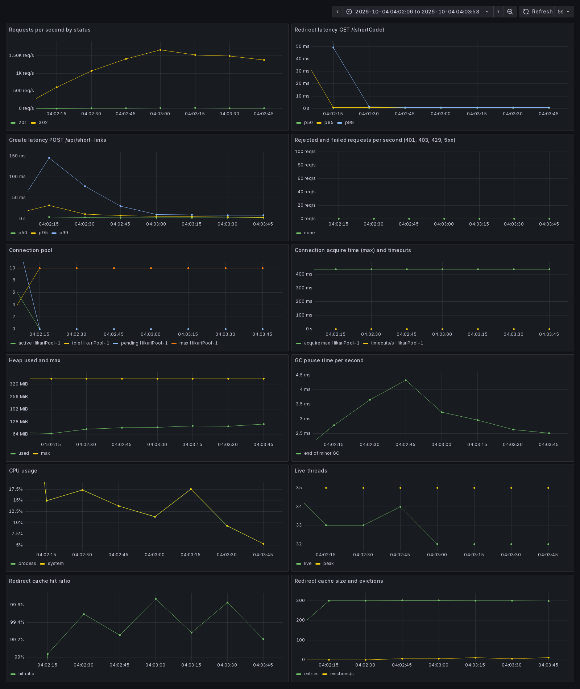
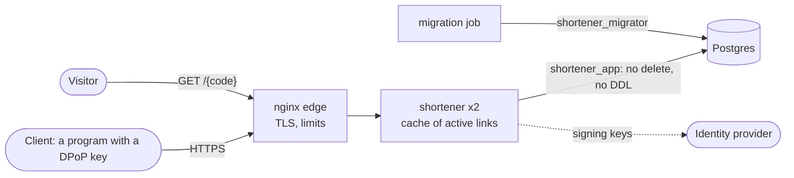

# shortener

[](https://github.com/christ008/shortener/actions/workflows/ci.yml)

**TL;DR** A URL shortener you call from your own programs, built to be safe on the public internet. A program registers once,
gets a key, and creates short links through an HTTP API; anyone can follow a short link.

- **A stolen token is useless.** Each request is signed by the caller's own key, and each caller sees only its own links.
- **A link can't be hijacked.** A short code is never reused, and in production the app has no permission to change one.
- **Fast.** Redirects come from memory.
- **Ready to run.** One command deploys it with TLS, metrics and alerts, after checking the release's signature.
- **Every choice explained.** A threat model, a short record per decision with its cost, and a test behind each guarantee.

> [!NOTE]
> **Live: <https://shortener.codes>**, a small demo with no promise of availability. Follow a link: <https://shortener.codes/RQM4j56>. See [CLOUD.md](docs/CLOUD.md).
> The performance figures below come from load tests on one machine, not from this instance.

<p align="center">
  
</p>

Spring Boot 4.2 · Kotlin 2.4 · Java 25 · Postgres 18 · Keycloak 26 · nginx · Apache-2.0

## Who does what

Links are created by programs, not in a browser: there is no web page to sign in to yet ([docs/UI.md](docs/UI.md) plans one).

| Role | Is | Can |
|---|---|---|
| **Client** | a program or script, usually a developer's, registered with the service and holding its own key | create links with a generated or a chosen code, list and read them, see their click counts, disable them. Only its own: another client's link answers `404` |
| **Visitor** | anyone with a short link, with no key or account | follow it: `GET /{code}` redirects |
| **Administrator** | a client with the administrator scope, or a person with a second factor | read and disable any client's links, to take one down |

A developer becomes a client with an invitation from the operator, in one command ([DEPLOY.md](docs/DEPLOY.md#registering-a-client)).

## What it does

- Creates a link with a generated code (7 base62 characters) or a chosen one, and redirects `GET /{code}` with `302`, not `301`,
  so a browser does not keep following a link after a takedown.
- A client lists, reads and disables its own links, and reads how often each was followed (approximate, counted off the redirect's
  path: [ADR 0037](docs/adr/0037-click-analytics-counted-off-the-hot-path.md)).
- A disabled link answers `410` and keeps its code: a code is never handed out twice. A takedown reaches every instance within
  the cache TTL (30 s).

Not goals: editing a link's target, expiry, teams or shared ownership, several short domains, and billing. Not built yet: where
a click came from (referrer, language) and a web UI.



## Properties

| Property | How | Where |
|---|---|---|
| A stolen token is useless | DPoP-bound tokens; HMAC nonces that any instance can check | [SECURITY.md](docs/SECURITY.md#dpop-rfc-9449), [ADR 0032](docs/adr/0032-dpop-nonces.md) |
| A code is never reused, even by a compromised application | the application's database role cannot delete a row or change a code | [Roles and migrations](docs/INTERNALS.md#roles-and-migrations) |
| Redirects survive a database outage, for a bounded time | a cache of active links with `stale-if-error`; readiness leaves the database out | [Redirect cache](docs/INTERNALS.md#redirect-cache), [ADR 0012](docs/adr/0012-readiness-excludes-the-database.md) |
| A client sees only its own links | ownership checked in the service; another client's link is `404` | [SECURITY.md](docs/SECURITY.md#authorization) |
| Production refuses an unsafe configuration | no target-host decision, DPoP off or no nonce secret stops the start | [Invariants](docs/DESIGN.md#invariants) |
| One JVM image, at least 12,000 req/s on 2 CPUs behind the edge | Liberica Lite 25, G1, compact object headers | [Performance](docs/INTERNALS.md#performance), [ADR 0036](docs/adr/0036-jvm-image-for-arm64.md) |
| Each invariant has a test | the test that fails without it | [Invariants](docs/DESIGN.md#invariants) |

## Run it

Needs Docker and JDK 25. The reference DPoP client needs JDK 17 or newer.

```bash
deploy/keycloak/dev-setup     # once: generates keys and passwords (builds its tools the first time)
./gradlew bootRun             # starts Postgres and Keycloak from compose.yaml, then the app on :8080
```

> [!WARNING]
> `dev-setup` writes git-ignored keys, a dev realm and `.env`. These are throwaway: never use them anywhere real.

Then call it, rehearse the production stack on your machine, and go to production with a checklist:
[docs/OPERATING.md](docs/OPERATING.md). Metrics, dashboard and traces: `docker compose --profile observability up -d`, then
<http://localhost:3000/d/shortener/shortener> ([OBSERVABILITY.md](docs/OBSERVABILITY.md)).

## The public instance

<https://shortener.codes> accepts links to `example.com` only. Following a link needs nothing; creating one needs a client. Ask for an invitation, then register
your own with `java deploy/keycloak/DpopClient.java register NAME INVITATION KEY_FILE` ([DEPLOY.md](docs/DEPLOY.md#registering-a-client)). With its key file:

```bash
export TOKEN_URL=https://shortener.codes/realms/shortener/protocol/openid-connect/token ISSUER=https://shortener.codes/realms/shortener
java deploy/keycloak/DpopClient.java call KEY_FILE CLIENT_ID POST https://shortener.codes/api/short-links '{"targetUrl":"https://example.com/some/long/path"}'
```

## API

| Request | Scope | Success | Errors |
|---|---|---|---|
| `POST /api/short-links` | `shortlinks:create` | `201` with the link and its `Location`. The code is generated, and `shortUrl` is the URL to share | `400` |
| `PUT /api/short-links/{code}` | `shortlinks:create` and `shortlinks:claim` | for a code you choose: `201`, or `200` when you already have this link, so repeating is safe | `400`; `409` when the code is reserved, taken, or yours for another target |
| `GET /api/short-links?page&size&sort` | `shortlinks:read` | `200` with `items`, `page`, `size`, `hasNext`, `totalItems` and `totalPages`. Sort by `createdAt` or `shortCode` | none of its own |
| `GET /api/short-links/{code}` | `shortlinks:read` | `200` | `404` |
| `GET /api/short-links/{code}/stats?granularity&from&to` | `shortlinks:read` | `200` with the clicks of the link as a series of hours or days, and their total. Approximate ([ADR 0037](docs/adr/0037-click-analytics-counted-off-the-hot-path.md)) | `400` for a window it cannot answer; `404` |
| `PATCH /api/short-links/{code}` with `{"disabled": true}` | `shortlinks:delete` | `200` with the link, disabled. Repeating is safe | `400`; `404` |
| `GET /{code}` | none | `302` | `404`; `410` when disabled |

- `shortlinks:admin` reads and disables any client's links.
- Errors: `401` with a `DPoP` challenge, `403` with `insufficient_scope`, `429` and `503` with `Retry-After`.
- Scope names are configuration (`shortener.shortlink.scopes.*`).
- Contract: [docs/openapi.yaml](docs/openapi.yaml). A test fails if it drifts from the code.

## Configuration

Defaults suit development. A deployment sets `.env` and a few secret files, and the `production` profile (JSON logs, no internals
in errors or health, 5% trace sampling, DPoP required) is set by the stack. Every variable, where it goes and what reads it:
[docs/REFERENCE.md#configuration](docs/REFERENCE.md#configuration).

## Evidence

- **Tests:** 644, all passing, 479 of them on the service. Line coverage 97.3%, branch coverage 91.7%.
- **Mutation score:** 92% on the logic of the `shortlink` and `security` modules (249 mutants). [INTERNALS.md#testing](docs/INTERNALS.md#testing)
- **Security:** the controls, and a STRIDE model with the open findings, their severities and the risks accepted.
  [SECURITY.md](docs/SECURITY.md), [THREAT_MODEL.md](docs/THREAT_MODEL.md)
- **Performance:** one desktop, a synthetic load of 99% redirects on links the cache holds. With 2 CPUs a JVM sustains at least 12,000 req/s behind the edge of the stack, and the native image it replaced 6,000.
  The figure is for the cache, not the database. Method and a warning to read before load testing:
  [INTERNALS.md#performance](docs/INTERNALS.md#performance).
- **Decisions:** one ADR each, with its cost. [docs/adr/](docs/adr/README.md)

## Build, test, package

```bash
./gradlew spotlessCheck         # lint; ./gradlew spotlessApply fixes what it can
./gradlew test                  # integration tests use Testcontainers (Docker)
./gradlew bootBuildImage        # JVM image on Alpaquita (glibc) by Paketo buildpacks; arm64 on an arm64 machine
perf/smoke.sh                   # every endpoint, with real tokens, against a running instance
```

## Deploy

`deploy/stack/compose.prod.yaml` is the production stack, for Docker Swarm or one host with Compose: an nginx edge with TLS, two
application tasks, a migration job, Postgres, and optional overlays in `deploy/stack/overlays/` for Prometheus, Keycloak and
Postgres backups with a replica. `deploy/stack/deploy.sh` verifies the image's signature before it deploys.

| Document | Contents |
|---|---|
| [OPERATING.md](docs/OPERATING.md) | develop, rehearse production, a go-live checklist, call the API, troubleshoot |
| [REFERENCE.md](docs/REFERENCE.md) | every configuration key, secret file and script |
| [DEPLOY.md](docs/DEPLOY.md) | production stack runbook: first deploy, updates, Keycloak, backups |
| [OBSERVABILITY.md](docs/OBSERVABILITY.md) | metrics, dashboard, traces, alerts, logs |
| [INTERNALS.md](docs/INTERNALS.md) | request flows, database, cache, image, deployment, tests and measurements |
| [DESIGN.md](docs/DESIGN.md) | invariants, modules, types, conventions |
| [SECURITY.md](docs/SECURITY.md) | the controls: filter chain, tokens, DPoP, scopes, rate limits |
| [THREAT_MODEL.md](docs/THREAT_MODEL.md) | STRIDE, OWASP, the open findings, and the risks accepted |
| [adr/](docs/adr/README.md) | decision records: why each choice, and what it costs |
| [CLOUD.md](docs/CLOUD.md), [UI.md](docs/UI.md) | the public instance: shape, setup, cost, status; a plan for a web UI (nothing built) |
| [openapi.yaml](docs/openapi.yaml) | API contract |

Releases are tagged `v0.x.y`: a minor version for a change, a patch for a fix to a release.

## Built with AI

Built with [Claude Code](https://claude.com/claude-code) since 2026-09-19; about three in four commits name Claude as co-author.

- The requirements and constraints are the author's, and every change is reviewed.
- Each claim in the docs names its test or measurement; mutation testing and a smoke test of the shipped image check the tests and the image.
- The ADRs and the threat model record each decision with its cost and the alternatives rejected.

## License

Copyright 2026 Christian Tejeda. Licensed under the [Apache License, Version 2.0](LICENSE).
