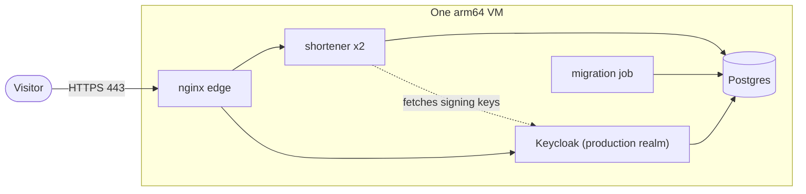

# A public instance in the cloud

Plan for an instance anyone can try. The production stack is rehearsed on one machine ([DEPLOY.md](DEPLOY.md)).

> [!NOTE]
> A plan. Nothing here has been deployed.

- [Goal](#goal)
- [Shape](#shape)
- [To decide](#to-decide)
- [Missing](#missing)
- [Steps](#steps)
- [Safety](#safety)
- [Cost and teardown](#cost-and-teardown)

## Goal

Someone with a terminal and a JDK 17 or newer follows the README against a real URL: gets a token, creates a link, follows
it, and sees that another client cannot see it.

## Shape

One arm64 VM (Ubuntu 24.04 on AWS, a Graviton `t4g.medium` in `us-east-2`: 2 vCPU and 4 GB) running `deploy/stack/compose.prod.yaml` on a single-node Swarm. Oracle's Always Free Ampere A1 (up to 4 OCPU and 24 GB for the account) is the same shape and costs nothing, when Oracle has capacity: a script that retries until it does is the cheapest way to get one.

- **Edge:** nginx with a Let's Encrypt certificate for one host name, issued over HTTP-01 and renewed by certbot's timer ([DEPLOY.md](DEPLOY.md#certificate)).
- **Identity:** Keycloak with the production realm, behind the edge under `/realms/shortener` ([DEPLOY.md](DEPLOY.md#keycloak)).
- **Database:** the stack's Postgres on the VM's disk, backed up by the [backups overlay](DEPLOY.md#backups-and-a-replica), Keycloak's database included, to a repository off the VM.
- **Image:** `ghcr.io/christ008/shortener:<version>`, arm64 only ([ADR 0036](adr/0036-jvm-image-for-arm64.md)). Graviton is arm64, and 20% cheaper than the x86 instance of the same size. An amd64 host builds its own with `./gradlew bootBuildImage`.
- **Memory:** the limits of the stack add up to about 3.5 GB with Keycloak and the backups overlay, and Prometheus (`OBSERVABILITY=1`) does not fit in 4 GB. `bootstrap.sh` adds a 2 GB swap file. Use a `t4g.large` (8 GB) for Prometheus.
- **Not measured on Graviton or Ampere:** the figures in [Performance](INTERNALS.md#performance) are from an x86-64 desktop. A `t4g` has burstable CPU: a long load test spends its credits.

## To decide

| Decision | Options |
|---|---|
| Provider | AWS (decided 2026-10-11): `t4g.medium`, `us-east-2`, with the free plan's credits. Oracle's Ampere A1 is the free alternative. Another arm64 VM works; an amd64 one needs the image built there |
| Host name | a domain or subdomain you control; the token `iss` must equal the public issuer URL |
| Who can create links | the dev clients' public keys, or a demo client whose key is published in the README |
| Certificate | decided: `certbot --webroot` through the edge, with the secrets named after their contents ([DEPLOY.md](DEPLOY.md#certificate)). Written, not run against Let's Encrypt |

## Missing

Built: the Keycloak overlay, the edge route for `/realms`, the production realm
(`./gradlew productionRealm`: `demo-client` and `admin-client`, no users), and backups with a restore test
([DEPLOY.md](DEPLOY.md#backups-and-a-replica)), with the repository on the VM's disk.

Run once, on 2026-10-11: `deploy/aws/launch.sh` (the VM, its security group and Elastic IP), `deploy/aws/bootstrap.sh` (Docker, cosign, certbot, Swarm,
secrets, `.env`) and `deploy/stack/certificate.sh` with the ACME overlay, on a `t4g.small`, up to a staging certificate served by the edge. The free
plan refuses a `t4g.medium` (`RunInstances` says the type is not eligible); `ec2 describe-instance-types --filters Name=free-tier-eligible,Values=true`
lists what it accepts: `t4g`, `t3` and `t8i` `micro` and `small`, and the x86 `c7i-flex.large` and `m7i-flex.large`.

The same day the stack ran with the signed image of 0.22.1 (`deploy.sh` verified the signature; v0.22.0 was never published, because its Release failed the
vulnerability scan). Both tasks of the application ran in production mode, `shortener.codes` answered `404` for an unknown code, `401` with `WWW-Authenticate: DPoP` to
a create without a token, and a redirect from HTTP to HTTPS. Two tasks starting together on the 2 vCPUs took 27 and 29 seconds, which the health check's start period then
allowed 15 s plus three failures of 5 s; Swarm killed them once and the second start passed. **Not run:** Keycloak (it does not fit in 2 GB), so no token and no link
could be created; the backups; a real certificate.

Not built:

1. The backup repository off the VM.
2. The `shortener-ui` client and web users (they wait for the [web UI](UI.md)).
3. A timer for `backup full` and `diff`: the crontab of [DEPLOY.md](DEPLOY.md#backups-and-a-replica).

## Steps

1. Make a budget alert first: `aws budgets create-budget` or the console (AWS Settings > Billing). The credits end on the date `aws freetier get-account-plan-state` prints.
2. `AWS_REGION=us-east-2 deploy/aws/launch.sh` creates the VM and prints its address. Create the DNS record for the host name.
3. On the VM: `git clone`, then `HOST=... ALLOWED_TARGET_HOSTS=... VERSION=... deploy/aws/bootstrap.sh`. It installs Docker, cosign and certbot, starts the
   Swarm, makes the secrets, builds the Keycloak and Postgres images and writes `.env`.
4. Make the production realm on your machine ([DEPLOY.md](DEPLOY.md#keycloak)) and copy `shortener-realm.production.json` to the VM.
5. `sudo deploy/stack/certificate.sh placeholder <host>`, `deploy/stack/deploy.sh <version>` (it reads the overlays from `.env`), then
   `sudo deploy/stack/certificate.sh issue <host> <email>`. Try it once with `STAGING=1`: the real service allows five failures an hour.
6. `deploy/postgres/backup init`, the crontab, and `docker service ls`.
7. `perf/smoke.sh` against the public URL with the demo client.
8. Publish the demo client's key and the README commands with the URL.

## Safety

Before anyone is invited:

- Set `SHORTENER_SHORTLINK_TARGETURLS_ALLOWEDHOSTS` to a short list (`example.com`, `*.example.org`). Anything else is
  refused with `400`. Never use `ALLOW_ANY_TARGET=true` on a public instance.
- Use the realm `./gradlew productionRealm` writes, never the dev one.
- Keep the default [rate limits](REFERENCE.md#tunables).
- Keep an administrator client whose key only you hold. Takedown: `PATCH /api/short-links/<code>` with `{"disabled": true}`.
- Say in the README, next to the URL, that availability is not promised.
- Store nothing you would mind losing: one disk, one machine.

Known limits: rate limits and the DPoP replay cache are per task, the VM is a single point of failure, and backups stay on its disk until the repository leaves it.

## Cost and teardown

- The VM is most of the bill, plus the snapshot or off-site dump. On the free plan the bill is paid from 200 USD of credits that end on
  2027-04-11 (about 6 months). On-demand prices in `us-east-2` (checked 2026-10-11; `sa-east-1` costs about 60% more):

  | | per month |
  |---|---|
  | `t4g.medium` | 24.5 USD |
  | 30 GB `gp3` | 2.4 USD |
  | public IPv4 (the Elastic IP) | 3.7 USD |
  | **about** | **31 USD**, 185 USD in six months, plus data out |

  That is inside the credits with little to spare, and a `t4g.large` is not: 295 USD. Set the alert at 150 USD.
- Teardown: `docker stack rm shortener`, then `AWS_REGION=us-east-2 deploy/aws/launch.sh teardown` (instance, Elastic IP, security group, key
  pair) and delete the DNS record. A released Elastic IP stops costing; a stopped instance with one does not.
