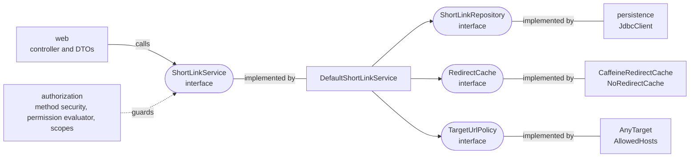

# Design

The invariants the code keeps, its modules and its types. The reasons are in the [ADRs](adr/README.md).

- [Invariants](#invariants)
- [Structure](#structure)
- [Domain types](#domain-types)
- [Conventions](#conventions)

## Invariants

Thirteen statements that hold, and what holds each one. A test is a result; a decision or a file is a design. A limit on an invariant is part of it.

### Short codes

| # | Invariant | Held by |
|---|---|---|
| 1 | A code is never reused | the code is the primary key and a claim is one atomic `insert ... on conflict do nothing`; the application's role can neither delete a row nor change a code, and a disabled link keeps its code. `DatabaseRolesTest`, `ShortCodeRaceIntegrationTest`, `DefaultShortLinkServiceTest`. [ADR 0013](adr/0013-three-database-roles-and-a-migration-job.md) |
| 2 | A disabled link answers `410` | a disabled link is a `410` at `GET /{code}`, and its code stays taken. `ShortLinkWebTest`, `DefaultShortLinkServiceTest`. [ADR 0033](adr/0033-link-is-a-resource-and-disabling-is-a-patch.md) |
| 3 | A redirect never needs a database write | the redirect path only reads, through the cache. `DefaultShortLinkServiceTest` counts the writes of a miss, a hit and an expiry: none. Counting the click is not a write of the redirect: it adds to a count in memory, and a timer writes the counts later ([ADR 0037](adr/0037-click-analytics-counted-off-the-hot-path.md)) |
| 4 | Staleness is bounded | a link disabled on another instance is followed for at most the cache TTL. **While the database is unreachable the bound is `stale-if-error`**, both [tunables](REFERENCE.md#tunables), and `shortlink_redirect_cache_stale_total` counts each such redirect. `DefaultShortLinkServiceTest`, `StorageUnavailableIntegrationTest`. [ADR 0011](adr/0011-in-process-redirect-cache.md) |
| 5 | The application's credentials cannot change the schema | `shortener_app` holds `select`, `insert` and `update (disabled_at, disabled_by)`, and the tables belong to `shortener_migrator`. `DatabaseRolesTest`. **In the stack only:** `bootRun` connects as the development superuser |

### Security

| # | Invariant | Held by |
|---|---|---|
| 1 | Production decides where links may point | without `allowed-hosts` or `allow-any=true` the application does not start. `TargetUrlPolicyDecisionTest`. [ADR 0015](adr/0015-target-host-policy.md), [0023](adr/0023-production-must-decide-its-targets.md) |
| 2 | DPoP is required | the default is on, and **`production` does not start with it off**, whatever an environment variable says. `DpopRequiredInProductionTest`, `ProfilesTest`, `ComposeStackTest`. [ADR 0006](adr/0006-require-dpop-bound-tokens.md), [0035](adr/0035-production-refuses-bearer-tokens.md) |
| 3 | The server enforces who owns a link | method security on the service, not the controller; another client's link is a `404`. `ShortLinkAuthorizationTest`, `UserOwnershipIntegrationTest`. [ADR 0007](adr/0007-owner-claim-and-ownership-rule.md) |
| 4 | Development cryptographic material is generated on the machine that uses it | `dev-setup` writes the keys, realm and passwords, and Git ignores them. `RepositoryHoldsNoSecretsTest` |
| 5 | Production secrets are never repository configuration | secrets are files read through `configtree`, never variables, and no tracked file holds a private key. `ComposeStackTest`, `RepositoryHoldsNoSecretsTest`. [ADR 0019](adr/0019-no-secrets-in-git.md). The k6 summaries under `perf/results/` are cleaned of the proof key and token that k6 copies into them (`perf/scrub-k6-summary.sh`) |

### Operations

| # | Invariant | Held by |
|---|---|---|
| 1 | An invalid production security configuration stops the start | in `production` the application refuses: no decision on target hosts, DPoP off, no shared nonce secret, or a DPoP filter missing from the chain. `TargetUrlPolicyDecisionTest`, `DpopNoncesConfigurationTest`, `DpopRequiredInProductionTest`. **Not covered:** the identity provider's addresses. The image keeps `localhost` defaults because the native build needs them when it is made (`ProfilesTest`), and the stack requires `ISSUER_URI` and `JWKS_URI` itself |
| 2 | Migrations run apart from the application | the migration job holds the only credentials that can alter the schema, migrates and exits. The application's role could not migrate if it tried. `ComposeStackTest`, `MigrateOnlyRunnerTest`. [ADR 0013](adr/0013-three-database-roles-and-a-migration-job.md) |
| 3 | Readiness and liveness are different questions | readiness leaves the database out, so an outage does not take the instances out of rotation, and liveness stays up. The container health check asks readiness. `StorageUnavailableIntegrationTest`, `ComposeStackTest`. [ADR 0012](adr/0012-readiness-excludes-the-database.md) |

## Structure

Two Spring Modulith modules: `shortlink` and `security`. In `shortlink` the public package is the contract and
everything else is an adapter behind it.

ArchUnit tests enforce what Modulith does not check inside a module:

- The public API depends on no JDBC type and no security type. It does use Spring Data's `Page` and `Pageable`, on purpose
  (see [Conventions](#conventions)).
- The web adapter talks only to the service interface.
- Nothing depends on the web or persistence adapters.
- JDBC types never leave `persistence`.

## Domain types

Absence and "unknown" are types, not nulls, so callers match on them and the compiler checks every case.

| Type | Replaces | Cases |
|---|---|---|
| `LinkStatus` | nullable `disabledAt` and `disabledBy` | `Active`, `Disabled(at, by)` |
| `Actor` | nullable creator and disabler names | `Client(name)`, `Unknown` for links stored before creators were recorded |
| `CreatedByFilter` | nullable `createdBy` in listings | `Anyone`, `Only(client)` |
| `LinkLookup` | nullable `findByShortCode` and `disable` | `Found(link)`, `Missing` |
| `InsertResult` | nullable `insertIfAbsent` | `Created(link)`, `Taken` |
| `RedirectCache` | a nullable cache field | `CaffeineRedirectCache`, `NoRedirectCache` (does nothing) |
| `RateLimitDecision` | nullable wait | `Allowed`, `Limited(retryAfter)` |
| `RateLimitKey` | nullable key | `Of(value)`, `Unlimited` |
| `AuthScheme` | nullable scheme | `DPOP`, `BEARER`, `NONE` |

Nulls remain only where a framework owns the signature: JDBC columns, Caffeine's loader, the request DTO, Spring
Security callbacks. They are converted at that boundary, and the JSON API still sends `null` for an absent
`createdBy` or `disabledAt` because the contract says so.

## Conventions

- **Spring facilities over bespoke code.** Method security with a `PermissionEvaluator`, `Pageable` and `Page`, Spring Security's resource server,
  DPoP and RFC 9728 metadata, MVC's problem details. Custom code is limited to the Bearer refusal, the DPoP nonces, rate limiting and the native hints.
- **Sealed failures.** `ShortLinkException` is `sealed`: the failures are exactly its subclasses in the package, and a test lists them.
- **Exhaustive `when`.** Sealed types (`LinkStatus`, `Actor`, `LinkLookup`, `InsertResult`, `CreatedByFilter`, `RateLimitDecision`, `RateLimitKey`, `AuthScheme`)
  are matched exhaustively, so a new case is a compile error. `SecurityProblemResponder` builds each scheme's challenge from a `when` over `AuthScheme`.
- **Rules live on the object that owns the data:** `link.isCreatedBy(client)`, `link.requireActive()`, `shortCode.requireClaimable()`,
  `CreatedByFilter.of(requested, caller, isAdministrator)`. A `TargetUrlPolicy` (`AnyTarget`, `AllowedHosts`) says whether a target is accepted.
- **Immutable authorization rules.** `ShortLinkScopes` is bound through its constructor and cannot change after start.
- **Boundaries are held by Spring Modulith and the ArchUnit tests**, not by Kotlin `internal`.
- **Spring Data's `Page` and `Pageable` are in the public contract** (the ArchUnit tests accept them on purpose); JDBC and security types are not.
- **The service opens its own observations** (`shortlink.load` marks a redirect that missed the cache).
- **No value classes** for `ShortCode`; data classes are used.
- **Reproducible image.** Everything the build downloads is pinned, by version where one exists and by digest where not.
