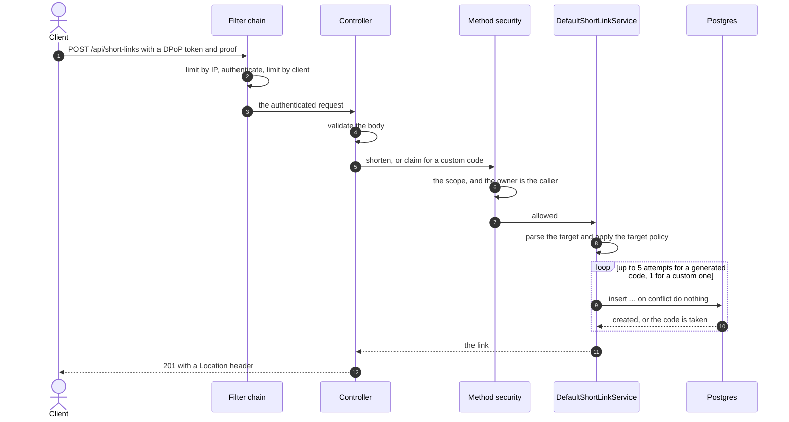
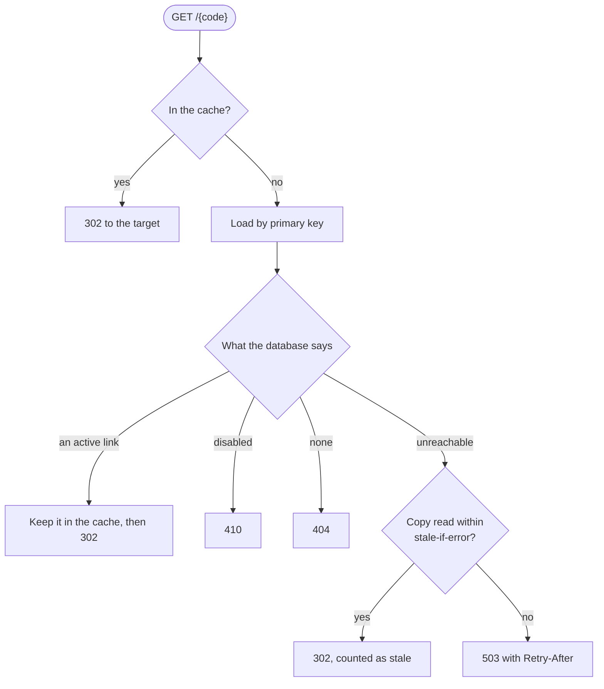
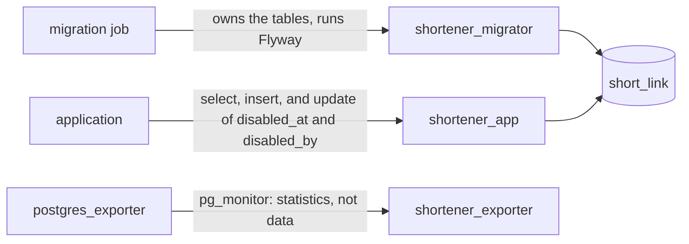
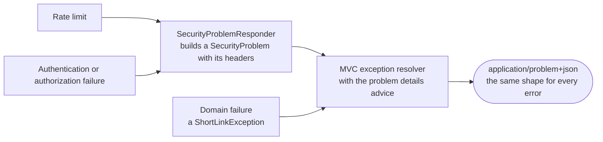
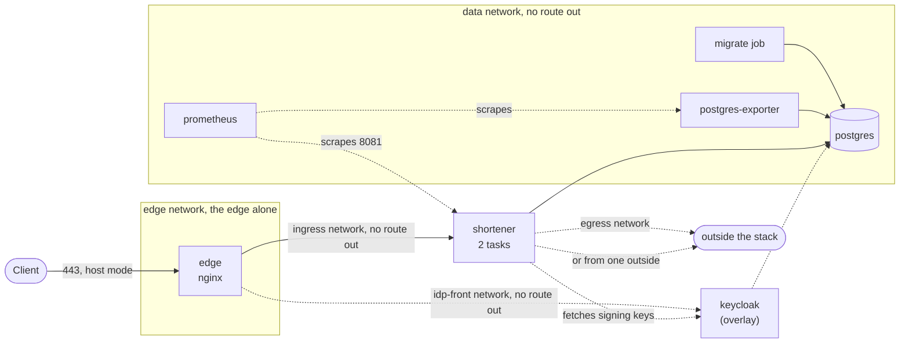
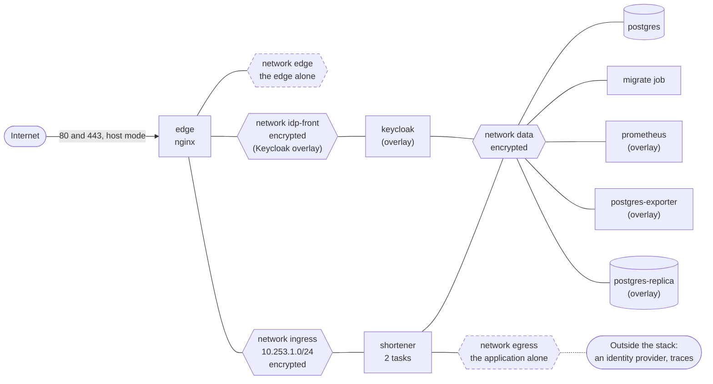
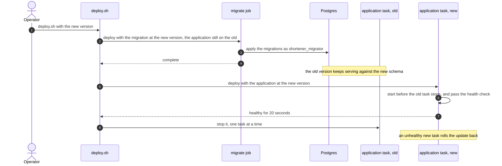

# Internals

What the service does and how it is built: request flows, the database, the cache, the image, the deployment, and the tests and
measurements. A statement that names a test or a measurement is a result; one that names neither is a design choice (the reasons are
in the [ADRs](adr/README.md)). [Limitations](#limitations) lists what is not shown.

- [Request flows](#request-flows)
- [Persistence](#persistence)
  - [Roles and migrations](#roles-and-migrations)
  - [Connections](#connections)
- [Concurrency](#concurrency)
- [Redirect cache](#redirect-cache)
- [Click counting](#click-counting)
- [Errors](#errors)
- [Observability](#observability)
- [Image](#image)
  - [Spring AOT, CDS and the JVM's AOT cache](#spring-aot-cds-and-the-jvms-aot-cache)
  - [The native image](#the-native-image)
- [Deployment](#deployment)
  - [Networks](#networks)
  - [Mutual TLS between the services](#mutual-tls-between-the-services)
  - [Hardening](#hardening)
  - [Edge](#edge)
  - [Rollouts](#rollouts)
  - [Not provided](#not-provided)
  - [Verified](#verified)
- [Releasing](#releasing)
- [Testing](#testing)
- [Performance](#performance)
- [Limitations](#limitations)

## Request flows

**Create** (`POST /api/short-links`)

1. Rate limit by IP, authenticate (DPoP; a Bearer token is refused), rate limit by client.
2. The controller validates the body and calls `shorten` (`POST`) or `claim` (`PUT`, the code from the path).
3. Method security checks the scope (`create`, plus `claim` for a custom code) and that the owner argument is the caller.
4. The service validates the URL again as a domain rule, then allocates a code:
   - Generated: drawn with `SecureRandom`, inserted with `insert ... on conflict do nothing`, retried up to 5 times, then `ShortCodeExhaustionException`.
   - Custom: one attempt. `api`, `actuator`, `error` and `app` are reserved. When the code is taken the service reads it: the caller's own
     link for the same target is the answer (`200`, nothing created, no audit event), anything else is `409`. A link's target never changes.
5. `201` (`200` for a repeated claim) with the link and, for `201`, a `Location` header, `/api/short-links/{code}`, built from the forwarded
   host and scheme. The link carries its `shortUrl`, `/{code}` on the same host, which is the URL to share.

**Redirect** (`GET /{code}`), public and the hot path

- Looks up the [redirect cache](#redirect-cache), then loads by primary key on a miss.
- `302` (never `301`, which a browser keeps past a takedown), `404` when unknown, `410` when disabled.
- A code is never handed out twice: it is the primary key, a disabled link keeps its row, and the application's database role has no
  `delete` and can update only `disabled_at` and `disabled_by`. In development, where the application connects as the database's superuser,
  that is the code's behaviour and not the database's.

**Disable** (`PATCH /api/short-links/{code}` with `{"disabled": true}`)

- Loads the link through `ManageableLinks`, whose `@PostAuthorize` lets only the owner or an administrator see it. Anyone else gets `404`.
- The update is `coalesce`-based: disabling twice keeps the first actor and time. The answer is the row the update returns, `200`.
- Only `{"disabled": true}` is accepted. Enabling again is refused.

**List** (`GET /api/short-links`)

- Takes a Spring `Pageable` (`page`, `size`, `sort`), capped at 200 (`spring.data.web.pageable.*`).
- A client lists its own links. An administrator lists one client's or all.
- Returns a Spring `Page`: the items, `hasNext`, `totalItems` and `totalPages`.
  - `hasNext` comes from fetching `size + 1` rows.
  - The total is read from the page when it ends the listing (the offset plus the rows returned) and for an empty first page. Only a page
    with more behind it, or a page past the end, runs `select count(*)`, filtered the same way.
  - The count is a separate statement, so a link created between the two can make them differ by one.
  - A page past the end is empty and carries the real totals.
- Sortable by `createdAt` and `shortCode` only, from a whitelist that maps to columns; a sort parameter never reaches SQL as text. Ties
  break on the short code, so pages never overlap.

## Persistence

Postgres 18 with plain JDBC through `JdbcClient`.

- `short_link` has the short code as its natural primary key.
- Constraints keep bad data out whatever writes it: the code matches `^[A-Za-z0-9_-]{3,32}$`, the target starts with `http://` or
  `https://`, and `disabled_at` and `disabled_by` are both null or both set.
- Listing indexes: `(created_at desc, short_code collate "C" desc)`, and the same behind `created_by`. Codes sort in byte order
  (`collate "C"`), so the order is the same on every database.
- Migrations are Flyway `V1` to `V7`.
- Storage that cannot serve the request becomes `StorageUnavailableException`: `503` with `Retry-After: 5`.
  - A failure to get a connection (`DataAccessResourceFailureException`).
  - A statement cut off at 5 s (`QueryTimeoutException`).
  - A lock given up after 2 s: an `UncategorizedSQLException` with SQLSTATE `55P03`, recognised by that code.
  - Any other database error is not mapped. `DatabaseLimitsTest` makes both limits fire on the repository's own query.

### Roles and migrations

`deploy/postgres/bootstrap.sql` is idempotent and runs once per database, as a superuser (the dev compose file and the stack run it when
the data directory is first created). It creates three roles:

- `shortener_migrator` owns the tables and runs Flyway.
- `shortener_app` serves requests.
  - Can `select` and `insert` on `short_link`, `update` only `disabled_at` and `disabled_by`, and read the Flyway history.
  - Cannot `delete`, `truncate`, change a target or a code, or run DDL.
  - `V6` states those grants next to the schema. Where the role does not exist, `V6` does nothing, so a developer's database with one user works.
- `shortener_exporter` has `pg_monitor`: it reads statistics, not data.

Limits on the application role apply at login, so no application setting lifts them and they hold behind a pooler:

| Setting | Value |
|---|---|
| `statement_timeout` | 5 s |
| `lock_timeout` | 2 s |
| `idle_in_transaction_session_timeout` | 10 s |

The migrator has `lock_timeout` 10 s, `idle_in_transaction_session_timeout` 60 s and no statement timeout.

The migration job (the `migrate` service of the stack):

- Runs the same image with `SHORTENER_MIGRATE_ONLY=true` and the migrator's credentials. `MigrateOnlyRunner` ends the process once Flyway has run.
- Only that service gets the migrator's password secret (`ComposeStackTest`).
- Flyway uses `SPRING_FLYWAY_*`, its own connection, so the pool's 15 s socket timeout does not cut a long migration short.
- A failed job retries up to five times. `deploy/stack/deploy.sh` runs it before it updates the application and waits for it, so a failed
  migration leaves the old version serving.
- The previous version keeps serving against the new schema during a rollout: migrations add, then switch, then remove in a later release.
- The application container still runs Flyway on start, as `shortener_app`, and finds nothing to apply. If the schema is behind, the role
  cannot change it and the container exits (`permission denied for schema public`).
- A database that predates the roles: run `bootstrap.sql`, which hands the existing tables to the migrator, then point the secrets at the new roles.

`MigrationConventionsTest` enforces, from `V6` on:

- A constraint is added `not valid` and validated in a later migration.
- An index is built `concurrently`, in a migration with a `.conf` file saying `executeInTransaction=false`.
- Retyping, `not null`, dropping or renaming a column needs a note (`-- unsafe-ok: <reason>`).
- It reads text and is not a SQL parser.

### Connections

- The pool is named `shortener`: 10 connections, 3 s wait. It keeps idle connections alive every two minutes and logs a connection held for more than 10 s.
- Every connection reports `shortener-<hostname>` as its application name.
- The driver waits at most 3 s to connect and 15 s for an answer, above the 5 s statement timeout, and keeps TCP alive.

## Concurrency

Requests run on virtual threads, so blocking JDBC does not hold platform threads. The database is bounded by the Hikari pool.

- Throughput is capped by what the pool can serve, not by threads.
- Each open connection holds about 150 KB of Tomcat buffers on the heap, so concurrency is bounded at the door: `server.tomcat.max-connections` (500)
  plus `accept-count` (100); the rest are refused.
- Shutdown is graceful: Spring stops accepting connections and waits up to 20 s for in-flight requests, inside the 30 s stop grace period.

## Redirect cache

An in-process Caffeine cache per instance, in front of the database read that every redirect costs.

- **What.** Active links only. An unknown code is never cached, and neither is a disabled link. Only `resolve` uses it; `get`, `list` and
  `disable` read the repository.
- **How long.** `shortener.shortlink.redirect-cache.ttl`, 30 s by default. The instance that disables a link evicts it at once. The others
  serve it until their entry expires, so a takedown reaches every instance within the TTL.
- **How many.** `max-entries`, 100,000 by default, evicted by Caffeine's admission policy. `enabled: false` swaps in `NoRedirectCache`.
- **Misses.** Concurrent misses for one code run one load and share it. A miss for an unknown or disabled code does a second lookup to tell them apart.
- **Metrics.** `cache_gets_total`, `cache_size`, `cache_evictions_total` for the cache `shortlink.redirect`.
- **Outages (`stale-if-error`, 5 minutes, `0` turns it off, never shorter than the TTL).** When the database cannot be reached and an entry has
  expired, the cache serves the last copy this instance read.
  - A code the instance never read gets `503`, and so does any failure that is not the database being unreachable.
  - The copies live in a second, equally bounded cache used only on that failure, so the hit ratio counts only what memory answered.
  - A link the database then reports gone or disabled is dropped, as is one disabled on this instance.
  - A link disabled elsewhere just before an outage keeps redirecting here until its copy expires.
  - Each redirect served this way increments `shortlink_redirect_cache_stale_total`, which should be zero.

## Click counting

An owner's view of how a link is followed, counted without touching the redirect ([ADR 0037](adr/0037-click-analytics-counted-off-the-hot-path.md)).

- **Capture.** `ShortLinkController.redirect` publishes `LinkFollowed(code, userAgent)` after `resolve` succeeded, for a `GET` only. A `HEAD`, an
  unknown code and a disabled link publish nothing. `ClickListener` classifies the `User-Agent` (`DeviceClassifier`: `desktop`, `mobile` or
  `bot`; no header is a bot) and records it. It never throws: a failure is counted in `analytics_clicks_dropped_total{reason="error"}`.
- **Hold.** `ClickAggregator` keeps a count per (link, hour, class) in a `ConcurrentHashMap`, added to atomically. It holds `max-entries` keys at most
  (50,000): a key already held always counts, and a click that needs a new key past the cap is dropped.
- **Write.** `ClickFlusher` drains it every `flush-interval` (10 s) in batches of `batch-size` (500). `JdbcClickStore` writes a batch with one
  statement, `insert ... select from unnest(...) on conflict do update set clicks = clicks + excluded.clicks`, so a batch is atomic and two instances add up.
- **Failure.** A batch that cannot be written goes back into the aggregator, up to the cap, and the flush ends. The first failure of a run and the
  recovery are logged with the exception's type and no statement. Readiness does not depend on it. A restart loses what was not flushed, and a
  shutdown flushes first, after the web server stops.
- **Role.** `shortener_app` can read and insert rows of `link_click_hourly` and update `clicks`, nothing else (`V7`, `DatabaseRolesTest`).
- **Off.** `shortener.analytics.enabled=false` swaps in `NoClickRecorder`: no aggregator, no flusher, no write.
- **Read.** `GET /api/short-links/{code}/stats` takes `granularity` (`hour` or `day`), `from` and `to`.
  - `Granularity` is a sealed type whose variants know where a bucket starts and ends, how wide a window may be (90 days of hours, 366 of days)
    and the default window.
  - `StatsWindow` rounds a request outward to whole buckets, in UTC, and refuses an empty or too wide one with `400`.
  - `DefaultClickStatsService` reads the link through `ShortLinkService.get` first (`404` for another client's link, any for an administrator),
    then the window with one grouped statement over the primary key range, and fills empty buckets with zeros.
  - `visitors` is desktop plus mobile; `bot` is never in it. Counts are read whether or not counting is on.
- **Not built.** Referrer and language, consolidation of old hours, and the alert on drops.

## Errors

Every error is an RFC 9457 problem detail (`application/problem+json`), rendered by Spring MVC.

- **Domain failures** extend `ShortLinkException`, a thin subclass of Spring's `ErrorResponseException`. Each carries its status and message;
  `StorageUnavailableException` adds `Retry-After`. Spring's `spring.mvc.problemdetails.enabled` advice renders them.
- **Security failures** (401, 403, 429) happen in the filter chain. `SecurityProblemResponder` builds a `SecurityProblem` (with `WWW-Authenticate`
  or `Retry-After`) and hands it to MVC's exception resolver, so the body has the same shape as every other error and follows the client's `Accept`.
- A `401` challenge names `DPoP` with the accepted algorithms, and `Bearer` as well unless DPoP is required. The error is:
  - `invalid_token`: bad token or wrong scheme.
  - `invalid_dpop_proof`: no proof, more than one, or a wrong one.
  - `use_dpop_nonce`: the proof lacks the current nonce, and `DPoP-Nonce` has it.
  - `insufficient_user_authentication`: a token with the administrator scope and no second factor, with the `acr_values` that would do ([ADR 0031](adr/0031-human-administrators-need-a-second-factor.md)).
- A request that presents its token in more than one way, such as two `Authorization` headers, is `400` with `invalid_request`
  (RFC 9449 section 7.2), refused before the filters that read the header ([ADR 0040](adr/0040-status-codes-of-the-dpop-errors.md)).

## Observability

What is reported, the dashboard, the traces and the alerts: [OBSERVABILITY.md](OBSERVABILITY.md).

- Readiness excludes the database; an instance answers what it can and gives `503` with `Retry-After` for the rest.
- The trace exporter is always built in. The endpoint has a default in `application.yaml`, and environment variables override it.
- Metrics are labelled by route template, so short codes are never label values.
- The management port is internal: health and metrics are never proxied by the edge.
- The database reports on itself without the application: slow-statement logging, an exporter that cannot read data, and a diagnostics script
  (`deploy/postgres/diagnostics.conf`, `perf/pg-diagnostics.sql`).

## Image

Built by `./gradlew bootBuildImage` through Paketo buildpacks on BellSoft's Alpaquita (glibc) builder, as a JVM image ([ADR 0036](adr/0036-jvm-image-for-arm64.md)).
The target is arm64.

- **Platform.** The builder and run image have amd64 and arm64, and the image takes the platform of the Docker daemon that builds it. The Release
  workflow builds on an arm64 runner and fails if the image is not arm64.
- **Pinned.** The builder and the run image are pinned by digest in `build.gradle.kts`. `syft` 2.43.0 is added by version in place of the builder's
  2.42.1, which downloads an amd64 binary on arm64 ([syft#479](https://github.com/paketo-buildpacks/syft/issues/479); remove the pin when the builder's digest carries 2.43.0 or later).
- **JVM.** Liberica JRE Lite 25. `JAVA_TOOL_OPTIONS` carries `-XX:+UseG1GC -XX:+UseCompactObjectHeaders -XX:ReservedCodeCacheSize=64M`, appended
  by the builder's `environment-variables` buildpack (`BPE_APPEND_...`), so an operator's own options are added to them.
- **Memory.** The buildpack's memory calculator sets `-Xmx` from the container limit when it starts: it subtracts direct memory (10 MB), metaspace
  (123 MB, for 19,000 classes; the application loads about 17,600 and uses 83 MB), the code cache and the thread stacks (1 MiB each).
  The image sets the code cache to 64 MB (the application used 16 MB after the smoke test) and `BPL_JVM_THREAD_COUNT` to 50 (`BPE_OVERRIDE_`, because
  `spring-boot` runs before `environment-variables`). The heap is 274 MiB on 512 MiB and 798 MiB on 1 GiB. `-XX:+ExitOnOutOfMemoryError` comes from
  the Liberica buildpack. Native memory tracking is off (`BPL_JAVA_NMT_ENABLED`).
- **Profile.** `SPRING_PROFILES_ACTIVE` defaults to `production` in the image, and the stack sets it too. The profile and properties are read when the container starts.
- **Health check.** `/workspace/health-check` (Tiny Health Checker) with `THC_PORT=8081` and `THC_PATH=/actuator/health/readiness`.
- **Start.** The stack gives a task 60 s (`start_period`) before failures of the check count. Ready after about 4 s on a desktop; two tasks starting
  together on a 2 vCPU `t4g.small` took 17 to 29 s.
- **Runtime.** About 240 MiB resident after the smoke test, about 400 MB uncompressed. Runs as uid 1000 and is healthy under `--read-only`,
  `--cap-drop ALL` and `no-new-privileges` with a 16 MiB `/tmp`.
- **Warm-up.** About the first 15 s are slow while the JIT learns ([Results](#results)).
- **Not measured.** Anything on Ampere. The collector, the heap and the 512 MiB limit were chosen on an x86-64 desktop.

### Spring AOT, CDS and the JVM's AOT cache

| | What it is | When | Buildpack flags |
|---|---|---|---|
| **Spring AOT** | the application's context, generated as code | in `bootJar` (`processAot`) | `BP_SPRING_AOT_ENABLED`, `BPL_SPRING_AOT_ENABLED` |
| **CDS** | the JVM's archive of loaded classes | a training run in the image build | `BP_JVM_CDS_ENABLED`, `BPL_JVM_CDS_ENABLED` |
| **The JVM's AOT cache** (JEP 483, 514, 515) | the same plus what the JIT learned | a training run, or a cache shipped in the jar | `BP_JVM_AOTCACHE_ENABLED`, `BPL_JVM_AOTCACHE_ENABLED`, `BP_JVM_AOTCACHE_PATH`, `BPL_JVM_AOTCACHE` |

- **State here: all three off.** The jar is not AOT-processed.
- `processAot` writes 231 `*__BeanDefinitions` classes (under the `production` profile that `build.gradle.kts` passes) and 273 hint entries
  (`META-INF/native-image`). A JVM uses the classes only with `-Dspring.aot.enabled=true`. What the build decided is fixed: a property or profile set only when the container starts has no effect on it.
- Time to ready on the image's JRE, 2 CPUs and 512 MiB, three runs each:

  | | Ready | `Started ... in` |
  |---|--:|--:|
  | plain jar | 4.8 to 5.2 s | 4.1 to 4.3 s |
  | AOT jar, property off | 4.9 to 5.1 s | 4.1 to 4.3 s |
  | AOT jar, `-Dspring.aot.enabled=true` | 4.3 to 4.5 s | 3.5 to 3.7 s |

- `BP_SPRING_AOT_ENABLED=true` adds `-Dspring.aot.enabled=true` to `JAVA_TOOL_OPTIONS`, only if the jar has `META-INF/native-image`. The manifest entry
  `Spring-Boot-Native-Processed: true`, which the Spring Boot plugin writes whenever the GraalVM plugin is applied, makes the JVM builder's detector fail,
  so `build.gradle.kts` applies that plugin only with `-Pnative`.
- CDS and the AOT cache are tied to the JDK, the architecture and the jar. The buildpack's training run starts the application during the image build,
  where there is no Postgres; whether it succeeds without one was not tried. A cache recorded elsewhere is shipped with `BP_JVM_AOTCACHE_PATH`.
  Measured: the AOT cache took the start to 3.9 s and the p95 of the first 15 s from 31 ms to 2.5 ms, for up to 25% more CPU a request once warm.

### The native image

The service was built as a GraalVM native image until 0.21.1 ([ADR 0017](adr/0017-native-image-on-a-pinned-base.md), on hold). `perf/builds/native.sh` and
the `nativeCompile` task still build one for the benchmarks, and its hints are still in the code.

- **Measured:** Liberica NIK, `-Os`, `-march=compatibility`, amd64: ready in 0.35 s, about 100 MB at rest, a 125 MB binary in a 205 MB image, 3 minutes and about 7 GB to build.
- **Hints in the code:**
  - `CaffeineRuntimeHints` registers every generated Caffeine cache and entry class on the classpath.
  - `DpopRuntimeHints` registers what the DPoP filter needs, and a startup check fails if DPoP is required and the filter is missing.
  - `AuthorizationRuntimeHints` registers what the SpEL expressions read by reflection (`authentication.name`, `#createdBy.name`, `#filter.isLimitedTo(...)`).
- **Rules that follow from it:** no `@ConditionalOnProperty` or `@Profile` for beans that depend on run-time settings (`MigrateOnlyRunner` reads
  `shortener.migrate-only` when it runs; `TargetUrlPolicyConfiguration` reads the profile when it creates the bean); `management.server.port` is set in
  `application.yaml`, not the environment; `server.tomcat.mbeanregistry.enabled` stays off.
- Unit tests cannot run a native image: `perf/smoke.sh` exercises every endpoint with real tokens.

## Deployment

One file, `deploy/stack/compose.prod.yaml`, runs as `docker stack deploy` on Swarm and as `docker compose` on one host. Runbook:
[DEPLOY.md](DEPLOY.md). Why not Kubernetes: [ADR 0016](adr/0016-compose-and-swarm-instead-of-kubernetes.md).

Services:

- `edge`: nginx, unprivileged. TLS, redirect to HTTPS, limits. The only service that publishes ports.
- `shortener`: the application, two tasks, each with its own DNS address (`dnsrr`).
- `migrate`: the one-shot migration job.
- `postgres`: the database, on one node with a local volume. A managed database replaces it by dropping the service.
- Overlays in `deploy/stack/overlays/`:
  - `compose.observability.yaml`: Prometheus with the alert rules, and the Postgres exporter.
  - `compose.postgres-ha.yaml`: pgBackRest backups and a streaming replica ([DEPLOY.md](DEPLOY.md#backups-and-a-replica)).
  - `compose.keycloak.yaml`: Keycloak ([DEPLOY.md](DEPLOY.md#keycloak), [ADR 0025](adr/0025-keycloak-in-the-stack.md)).
  - `compose.console.yaml`: Keycloak's console at the site's address for connections from the node ([ADR 0041](adr/0041-keycloaks-console-through-an-ssh-tunnel.md)).
  - `compose.acme.yaml`: the challenge directory in the edge, for `certificate.sh`.
  - `compose.pki-ca.yaml`, `compose.pki.yaml`: the stack's CA, and mutual TLS between the services.

### Networks

Five networks, and a service is on each one it needs and no other ([ADR 0038](adr/0038-segment-the-stack-networks.md)); a sixth, `pki`, exists with the CA.
A dashed network has a route out; a solid one has none.

| From | To | Over | What |
|---|---|---|---|
| edge | shortener `8080` | ingress | HTTP with the client's address, scheme, host and port in `X-Forwarded-*`, which the application trusts from this network's subnet alone |
| edge | keycloak `8080` | idp-front | the `shortener` realm, the token endpoint and the registration of clients |
| shortener | keycloak `8080` | data | the signing keys of the tokens (`JWKS_URI`) |
| shortener, migrate, keycloak | postgres `5432` | data | SQL, as three different roles, and Keycloak's own database |
| prometheus | shortener `8081`, exporter `9187` | data | metrics; the management port is on no network the edge shares |
| shortener | the identity provider, a trace collector | egress | only without Keycloak in the stack, or with traces sent out |

- The edge shares exactly one network with each service it proxies to: Docker's DNS answers with the addresses of one shared network, and the
  application trusts only the `ingress` subnet (`10.253.1.0/24`, one value in `compose.prod.yaml` for the network and for
  `SERVER_TOMCAT_REMOTEIP_INTERNALPROXIES`). A second shared network would make the edge arrive from an untrusted address.
- Nothing but the edge publishes a port. Keycloak has no route out.
- Docker has no network policy: inside a network every member can call every other. Mutual TLS covers that ([below](#mutual-tls-between-the-services)).

### Mutual TLS between the services

With `PKI_CA=1` the stack has its own CA, step-ca, on a sixth network, `pki`, that is internal and holds the CA alone. With `PKI=1` the services use it
([ADR 0022](adr/0022-mtls-between-services.md), [DEPLOY.md](DEPLOY.md#mutual-tls-between-the-services)).

| Caller | Called | What it shows | What the called checks |
|---|---|---|---|
| edge | shortener `8080` | a client certificate, `spiffe://shortener.internal/prod/edge` | TLS 1.3 and the CA's chain (Tomcat), then the identity: `PeerIdentityFilter`, first in the security chain, answers `403` to any other |
| shortener, migrate | postgres `5432` | a client certificate, `CN=shortener-app` or `shortener-migrator` | TLS 1.3 and the chain, then `pg_ident.conf` maps the name to the role, and `pg_hba.conf` refuses the two roles anything else |
| the node | the CA | nothing: `docker exec` into it, with the provisioner's password | the policy, the template and the name constraints of the issuing CA |

- **Three levels.** The root is offline and signs the issuing CA once a year. The issuing CA's certificate has name constraints (the stack's DNS names
  and the `shortener.internal` URIs, no IP address). Services trust the root, so replacing the issuing CA changes nothing for them.
- **The CA holds no private key but its own.** The node makes each key and request with `openssl`, and the CA signs the request (`step ca sign`) with
  the template `deploy/pki/leaf.tpl`. Files are moved into place at the end, so a CA that fails leaves the old certificate.
- **Every key is ECDSA P-256 and every signature SHA-256.** A certificate signed with Ed25519 has no digest for SCRAM channel binding, which `libpq` asks for by default.
- **The application's TLS is a Spring SSL bundle** reading the files where the secrets are (`SPRING_SSL_BUNDLE_PEM_SERVER_*` as `file:` paths),
  `server.ssl.client-auth=need`, and TLS 1.3 set in the bundle. The management port shares `server.ssl` unless `management.server.ssl.enabled` is
  `false`, which the plain-HTTP health check needs. `PeerIdentityFilter` does not check requests that came in through the management port (`ManagementPort`).
- **The identity check is `PeerIdentityFilter`, not Spring Security's `x509()`**: the certificate names the proxy and not the user, so this
  authorizes the connection and does not authenticate a user.
- **Edge to application** is one included file, `upstream.conf` (plain HTTP) or `upstream.mtls.conf` (TLS 1.3, the edge's certificate, `proxy_ssl_verify on`).
- Production does not start with half of it (`requirePeerIdentityToMatchClientAuth`). `ComposeStackTest` holds who holds which key, the one-mount-per-secret rule, the networks and the names the CA signs for.

### Hardening

Every service runs with a read-only root filesystem, no capabilities, a non-root user, memory and CPU limits, rotated logs and secrets as files,
and only the edge publishes a port. `ComposeStackTest` holds each service to that. Only the edge's own network and the application's `egress` have a
route out, and the networks between services are encrypted across nodes on Swarm.

Exceptions, and what Swarm does differently:

- `no-new-privileges` is ignored (verified on Docker 29.8). The application, nginx and Prometheus images have no setuid binaries; Postgres has some, with every capability dropped.
- The short `tmpfs:` key is silently dropped: writable memory for `/tmp` uses the long `volumes:` syntax with a size.
- Postgres starts as root and hands over, and adds back the five capabilities its entrypoint needs.
- The edge publishes in host mode, so it sees client addresses.
- Secrets are mounted in memory at `/run/secrets` with the file's mode. The application and the migration job read the database password as the file
  `spring.datasource.password`; only the job gets `spring.flyway.password`.

### Edge

- Certificates are files (`tls_cert`, `tls_key` secrets), issued and renewed by `certbot` on the node ([DEPLOY.md](DEPLOY.md#certificate)). The edge answers
  HTTP-01 challenges from a mounted directory. A renewal is a new secret named after its contents and a deploy that replaces the edge.
- TLS 1.2 and 1.3, HSTS for a year, no session tickets, plain HTTP only redirects.
- Replaces the forwarded headers rather than appending: `X-Forwarded-Host` carries the host without its port (what Tomcat's `RemoteIpValve` reads),
  `X-Forwarded-Port` the port of the client's `Host` header (a DPoP proof names that port), `X-Forwarded-Proto` is the edge's scheme, and
  `X-Forwarded-For` is `$remote_addr`.
- Empties the forwarding headers the application does not read (`Forwarded`, `X-Forwarded-Prefix`, `-Ssl`, `-Server`, `-By`, `X-Real-IP`)
  (`ComposeStackTest`, `DpopIntegrationTest`).
- Caps bodies at 16 KiB, sets header, body and proxy timeouts (10 s), caps connections per address (100) and never proxies the management port.
- Reuses connections to the application (`upstream` with `keepalive`) and resolves `shortener` every 5 s, so tasks that come and go are followed without a reload.
- Reaches the application through one included file, `/etc/nginx/upstream.conf`: plain HTTP, or with `PKI=1` TLS 1.3 and its own certificate.
- Swarm configs cannot change once created, so `deploy.sh` puts a hash of each file in the config's name (nginx, Prometheus, the Keycloak realm and
  edge file, Postgres files, certificates).

### Rollouts

- The application updates one task at a time, new before old (`start-first`), waits for the health check, watches the new task for 20 s and rolls back if it fails.
- A stopping task may still be in nginx's DNS answer for a few seconds. nginx retries a request that failed to connect on the next address, for requests that are safe to repeat.
- Measured: 1,290 redirects at 20 requests a second during a forced rolling update of two tasks, every one answered. Creates were not measured: nginx does not repeat a request that was already sent.
- `deploy.sh` runs the migration job first, then the application.

### Not provided

- Egress filtering by destination. Every network but the edge's and the application's `egress` has no route out, and `egress` has all of it.
- Autoscaling. Replicas are set by hand.
- A `preStop` hook: a rollout relies on health gating, short DNS caching and a retry for repeatable requests.
- `no-new-privileges`.
- Changing a secret or a config in place: rotating one is a new name and a stack update.
- A highly available database. The optional overlay adds backups to a volume of the node and a replica on another, promoted by hand ([ADR 0028](adr/0028-postgres-backups-and-a-replica.md)).
- Publishing Prometheus to the loopback address only: it is not published.

### Verified

Docker 29.8, a single-node swarm and plain Compose.

| What | With | Result |
|---|---|---|
| The whole stack through the TLS edge, the 21-check smoke test (`perf/smoke.sh`) | native image 0.21.1, and the JVM image | passes on both |
| Hardening and the networks of ADR 0038 | JVM image 0.22.0 | the smoke test through the edge, two tasks resolved from the edge over `ingress` alone, Keycloak with no route out, a forged `X-Forwarded-Host` honoured from the edge and ignored from Keycloak |
| The migration job as the migrator from a file secret | | the application refuses to change the schema |
| Prometheus and the exporter | | both tasks discovered, alert rules loaded, `pg_up` reported |
| A rolling update under load | | see [Rollouts](#rollouts) |
| The edge on port 443 and on a published port other than 443 (9443) | nginx 1.31.5 | served with `X-Forwarded-Port`; refused with `invalid_dpop_proof` without it |
| The development stack | Keycloak 26.8.0, Prometheus 3.15.0, Grafana 13.2.3, Tempo 3.1.0 | a DPoP-bound token accepted by the nonce flow, the 21-check smoke test, the 25 queries of the dashboard returning data, traces in Tempo |
| The migration job under the `production` profile | | completes; it sets `allow-any`, since it checks no link ([ADR 0023](adr/0023-production-must-decide-its-targets.md)) |
| Redirects with Postgres stopped | native binary | a link read earlier kept redirecting; an unread code got `503` with `Retry-After`; readiness and liveness stayed up; recovery when Postgres returned; with the window at zero the same link answered `503` |
| Mutual TLS | Compose, one machine | works; not tried under Swarm |

What was not verified is in [Limitations](#limitations).

## Releasing

Change `version` in `build.gradle.kts` (the OpenAPI document and the deployment files must match; a test checks), commit, tag the commit
`v<version>` and push the tag. The `Release` workflow (`.github/workflows/release.yml`):

- refuses a tag that does not match the version in the build;
- runs the tests, builds the image on an arm64 runner, and smoke-tests that exact image against Postgres and Keycloak;
- scans it, and fails on a fixable high or critical vulnerability;
- pushes the image to `ghcr.io/christ008/shortener`, signs it by digest with the workflow's own identity (no key), and attaches an SPDX bill of
  materials. The job summary prints the digest and the `cosign verify` command.

Also:

- Only arm64 is built.
- The package is private after the first release; make it public in the repository's package settings, or give the hosts that pull it a registry login.
- Dependabot proposes updates weekly to the actions, Gradle (the application and `tools/`), the Dockerfiles and the compose files. Third-party
  actions are pinned to commits and `actions/*` to tags.
- `deploy/stack/deploy.sh` verifies the signature of a version (`cosign verify`, against the identity of this workflow for that tag) before it deploys.

## Testing

> [!NOTE]
> Measured on 2026-10-11 on one machine, with Docker: `./gradlew test koverHtmlReport koverXmlReport` and `./gradlew mutationTest`, Gradle 9.8.0 on a GraalVM CE 25.0.4.

| Kind | Tests | Where | Needs Docker |
|---|--:|---|---|
| The application: domain, service, cache, policy, web, persistence, security, architecture | 335 | `src/test` | 118 of them, in 24 classes that import `TestcontainersConfiguration` |
| Infrastructure of the repository | 64 | `src/test` | none |
| The tools ([ADR 0029](adr/0029-tools-in-kotlin.md)) | 80 | `tools/src/test` | none |
| **Total** | **479** | | all passed (`./gradlew test` runs the tools' tests too) |

### Coverage (Kover)

- Kover 0.9.11. `./gradlew test koverHtmlReport koverXmlReport` writes `build/reports/kover`; CI keeps it as the `coverage` artifact. There is no threshold.
- SonarCloud: CI runs `./gradlew sonar -x test` with the Kover XML report, for project `christ008_shortener` of organization `christ008`. It needs the
  `SONAR_TOKEN` secret and Automatic Analysis off; without the secret (a pull request from a fork) the step is skipped.
- Scope: the classes of `uy.ct.shortener`, from the 399 tests of `src/test`. The tools are not measured.
- Result: lines 97.2% (652 of 671), branches 91.2% (280 of 307), methods 93.9% (217 of 231), classes 94.6% (88 of 93).

  | Package | Covered | Total | Lines |
  |---|--:|--:|--:|
  | `shortlink` (the contract) | 70 | 71 | 98.6% |
  | `shortlink.internal` (service, cache, policy) | 157 | 159 | 98.7% |
  | `shortlink.internal.web` | 60 | 62 | 96.8% |
  | `security.internal` | 185 | 189 | 97.9% |
  | `shortlink.internal.authorization` | 32 | 33 | 97.0% |
  | `shortlink.internal.persistence` | 81 | 85 | 95.3% |
  | `security` | 60 | 64 | 93.8% |
  | `uy.ct.shortener` (the migration runner) | 7 | 8 | 87.5% |
  | **All** | **652** | **671** | **97.2%** |

### Mutation testing (PIT)

- PIT 1.30.0 with its JUnit 5 plugin (`info.solidsoft.pitest` 1.19.0). `./gradlew mutationTest` writes `build/reports/pitest`. It is run by hand, not in `check` or CI; a run takes 4 minutes.
- Scope, 249 mutants (PIT's default mutators):
  - `shortlink`: the domain types, `DefaultShortLinkService`, the redirect cache, the target-URL policy and the code generator (103 mutants).
  - `security`: the problem responder, the DPoP nonces and their converter and filter, the rate limiter and its filter, the security events, `AuthScheme`,
    the client converter, the sender-constrained token resolver and `SecurityConfiguration` (146 mutants).
  - Not the web and persistence adapters, authorization expressions, the audit trail, properties or native hints.
- Tests it runs: those that need no Docker, and the integration tests of `security`.
- Results:

  | Scope | Mutants | Killed | Survivors |
  |---|--:|--:|---|
  | `shortlink` | 103 | 99 (96%) | 4, none behaviour of the project: two Kotlin null checks on what a Java library returns, two inlined standard-library early returns |
  | `security` | 146 | 131 (90%) | 15, none behaviour of the project: nine Kotlin null checks, five in the check that the DPoP filter is in the chain (for the native image) and inlined standard-library calls, one with no coverage (the algorithm list is built at class load) |
  | **Together** | **249** | **230 (92%)** | 2 with no coverage; test strength 93% |

- 92% is a statement about 249 mutants of the logic of two modules; a surviving mutant is a question to read, not a defect.

### Where the evidence is

| Claim | Evidence | Docker |
|---|---|:-:|
| The application's role cannot delete a link or change a target, so a code is never handed out twice | `DatabaseRolesTest` `ShortLinkSchemaTest` | yes |
| Every request needs a token bound to the client's key, a proof for that request (including its port behind the edge) and the server's current nonce | `DpopIntegrationTest` `DpopNonceIntegrationTest` `DpopNoncesTest` `DpopClientTest` `ComposeStackTest` | partly |
| A takedown is bounded by the cache TTL, and a disabled or unknown link is never cached | `RedirectCacheTest` `DefaultShortLinkServiceTest` | no |
| Limits per address and per client answer `429` with `Retry-After` | `RateLimiterTest` `IpRateLimitIntegrationTest` `ClientRateLimitIntegrationTest` | partly |
| A database outage is `503`, and links already read keep redirecting | `StorageUnavailableIntegrationTest` `JdbcShortLinkRepositoryUnavailableTest` | partly |
| The stack is hardened, only the edge publishes ports, and the edge forwards the port | `ComposeStackTest` | no |
| `deploy.sh` verifies the signature, and refuses a bad name in `.env` | `DeployScriptTest` | no |
| The code and the contract agree, and the module boundaries hold | `OpenApiContractTest` `ModularityTests` `ShortLinkArchitectureTest` | partly |

*Partly*: only `DpopIntegrationTest` and `DpopNonceIntegrationTest` (tokens), `IpRateLimitIntegrationTest` and `ClientRateLimitIntegrationTest` (limits),
`StorageUnavailableIntegrationTest` (outage; the repository test uses hand-written fakes of the pool) and `OpenApiContractTest` (contract) need Docker.

## Performance

> [!IMPORTANT]
> One application instance with 2 CPUs on a desktop with 6 cores and 12 threads, which also ran the load generator, Postgres and the edge, each on
> cores of its own. One run a point. The figures compare builds and locate their knees; they are not a guarantee for another machine.

### Method

- `perf/bench.sh --scenario app|edge|full` runs one build against the compose Postgres and Keycloak under k6.
  - `app`: the application alone.
  - `edge`: the stack's edge in front of it (`deploy/edge/nginx.conf`, 1 CPU and 128 MiB, TLS and HTTP/2).
  - `full`: the edge plus the stack's other limits (the application on a CPU quota alone, Postgres at 2 CPUs and 1 GiB).
  - `perf/compare-builds.sh` runs one load on several builds.
- Load: k6 keeps offering a rate when the server slows down. Redirects to 300 seeded links (nearly all cache hits) and 15 creates a second signed
  with DPoP. 30 s of warm-up at 2,000 req/s, then 60 s a rate.
- A rate is **sustained** when at least 99% of the offered requests complete, fewer than 0.1% fail, and the redirect p95 as k6 saw it is within 25 ms.
  The **ceiling** is the highest sustained rate; the **knee** is the next one. The server's own p95 and p99 read 1.0 ms in every run (queueing happens
  before the handler), so they are not used.
- CPU time a request comes from `docker stats` and the requests served: `tools/run Report cpu`.
- The script guards against what invalidated runs: roles sharing a physical core, Docker Desktop's daemon (a VM), one DPoP key for all clients, the
  edge opening a connection per request, lowering a container's memory below its page cache, and a single source address meeting per-address protections.

### Results

In the stack's scenario (`full`, the edge without its per-address limit):

| | Native, Liberica NIK (`-Os`, the stack's image until 0.21.1) | Native, Oracle GraalVM (`-O3`, `x86-64-v3`) | JVM, Liberica Lite 25 (Parallel) |
|---|--:|--:|--:|
| **Ceiling**, `full` | 6,000 req/s | 10,000 | at least 12,000 |
| Ceiling, the application alone | 8,000 | 10,000 | at least 14,000 |
| CPU time a request, at 8,000 | 0.229 ms | 0.151 ms | 0.101 ms |
| CPUs used of 2, at 8,000 | 1.80 | 1.20 | 0.79 |
| Redirect p95 at 8,000, creates p99 | 27 ms, 527 ms | 1.2 ms, 40 ms | 0.5 ms, 6 ms |
| Memory | peak 250 MiB | peak 246 MiB | sustains 8,000 req/s in 256 MiB |
| Ready after `docker run` | 0.7 s | 0.6 s | 4.9 s |
| p95 in the first 15 s at 5,000 req/s | 1.4 ms | 0.5 ms | 31 ms (2.5 ms with the AOT cache) |

- The Liberica native image's CPU use falls once it passes its knee (1.80 CPUs of 2 at 8,000, 1.35 at 10,000): the collapse is queueing and stalls;
  the cause was not found. It is not the garbage collector (3.4% of the time, longest pause 46 ms), memory or the virtual-thread carriers.
- Oracle GraalVM with `-O3`, `-march=x86-64-v3` and glibc cut the cost of a request by a third; the vendor, `-O3`, `-march` and the libc were not separated.
- The JVM (warm) costs under half of the Liberica native image per request. On 2 CPUs Parallel was best, G1 with `-XX:+UseCompactObjectHeaders` equalled it,
  plain G1 and Serial (the JVM's own pick) were worse, and ZGC doubled the memory at rest. At 192 MiB the collector thrashes; from 256 MiB the load is sustained.
- The JVM pays at the start: about 15 s of JIT, in which 1 to 3% of the requests at 5,000 req/s did not complete.
- Through the edge: reusing connections to the application (`upstream` with `keepalive`) took the edge from about 470 req/s (ports ran out, then `502`) to 8,000
  with 28% of its CPU. `limit_conn per_address 100` counts every HTTP/2 stream in flight, rejects a source address that bursts past 100, and kept the stack serving in overload.
- 10M links the cache has not seen (table 806 MB, indexes 1.2 GB, loaded by `COPY` in 622 s), behind the edge with Postgres at 2 CPUs and 1 GiB:
  nothing failed in the application up to 2,000 req/s (failures were the edge's per-address limit) and Postgres was not the limit. Postgres at 512 MB
  was killed by the kernel; at 1 GiB it was not. 40,001 reads of 10 codes from an empty cache ran 21 queries: 10 at the start and 10 when the 30 s TTL expired.
- With the application's request limits on, one address gets 5 req/s (300 a minute). Every figure here lifts them.
- The DPoP replay cache holds 1,000 proofs per key for 30 s: a key sustains about 33 requests a second per instance, and a proof replayed to the other replica is not seen as a replay.
- A warm JVM costs about 45% of the Liberica native image for the same load and sustains at least twice the rate. The native images keep the start
  (0.6 s against 4 to 5 s) and no warm-up. Memory no longer separates them.

### Overload and the connection limit

Tomcat accepts at most 500 connections and the edge at most 100 in flight per address. Measured at 12,000 req/s on the Liberica native image, 1.5 times its ceiling of 8,000 (the application alone):

| | no limit (`max-connections` 8192) | `max-connections: 500` |
|---|--:|--:|
| peak memory | 512 MiB (the limit) | 271 MiB |
| time in GC, longest pause | 23.4%, 2.8 s | 2.6%, 107 ms |
| `OutOfMemoryError` | 3 | 0 |
| completed of the offered, failed | 52%, 16.6% | 83%, 0.6% |
| redirect p95 as k6 saw it | 434 ms | 64 ms |

The limit trades refused requests for flat memory and latency. It is protection, not capacity: creates still queue for seconds at that load.
Tooling: `perf/profile.sh`, `tools/run Report` (`gc` and `hprof`), `perf/tune-connections.sh`.

### Not measured

- Which part of the Oracle build's gain is the vendor, `-O3`, `-march` or the libc; the native image with G1 or profile-guided optimization.
- The JVM above 16,000 req/s (the load generator is the limit), on other CPU counts, and the JDK distributions against each other (Temurin and Liberica Lite gave similar results).
- A warm-up before the traffic and a rolling update with it; two replicas behind the edge; load beyond 60 s, a spike, a cold operating-system cache.

### Running load tests safely

> [!WARNING]
> The development machine runs an application firewall (Safing Portmaster) that inspects new connections through a kernel packet queue. Overload runs
> overflow it (`nfnetlink_queue: nf_queue: full ... dropping packets`) and every new connection fails until reboot.

- Keep to sustainable rates.
- Prefer host networking and loopback to the Docker bridge.
- Pause the firewall before saturation tests.
- When connections start timing out, check `journalctl -k | grep nf_queue`.

## Limitations

The one list of what is not shown and what is known to fall short. Other documents link here.

### Not run or not verified

- It has not served real traffic. Behaviour under load comes from a synthetic workload on one machine ([Performance](#performance)).
- `deploy.sh` has not been shown to verify a signature that the release workflow made.
- The stack has run on one node only: not overlay encryption between nodes, the host-mode edge on several nodes, or where Postgres lands ([Verified](#verified)).
- Not tried: pulling the image from a registry, and any failure of the database node.
- Reads of links the cache has not seen were measured only up to 2,000 req/s over 10M links, on one machine. A miss is a primary-key read with a 5 s limit,
  and concurrent misses for one code share one load. Where misses saturate Postgres is unknown.

### Known limits

- A link disabled on one instance can redirect on the others for up to the cache TTL.
- Rate limits and the DPoP replay cache are per instance.
- Beyond capacity (at least 12,000 req/s for the JVM image and 6,000 for the native image it replaced, on two cores of a desktop in the stack's scenario;
  none measured on Ampere) the service sheds load, but creates still queue for seconds. nginx caps connections per address but not in total; Tomcat caps at 500.
- The database connection is not forced to use TLS: the URL comes from the environment. Production should use `sslmode=verify-full`.
- Observability: no metrics from the nginx edge, no Grafana dashboard for Postgres, no alerts on the database server itself, and nothing delivers the alerts Prometheus fires.
- The migration history creates a table and drops it: `V2` made Modulith's event publication table and `V4` begins by dropping it. An applied migration is not edited (Flyway checks its checksum).
- The dev keys and passwords are generated per developer by `dev-setup`. The earlier committed ones are in the Git history and work against no setup made since.
